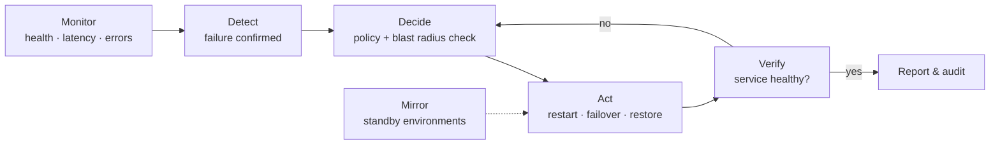

# AlwaysOn — Autonomous Infrastructure Recovery

> An autonomous platform that detects failures, mirrors environments, fails over across regions and recovers critical services, so your systems stay up even when no one is awake to fix them.


---

## Table of Contents

- [Overview](#overview)
- [Features](#features)
- [How It Works](#how-it-works)
- [Quick Start](#quick-start)
- [Configuration](#configuration)
- [Safety Guardrails](#safety-guardrails)
- [Use Cases](#use-cases)
- [Project Structure](#project-structure)
- [Integrations](#integrations)
- [Works Well with InfraTwin](#works-well-with-infratwin)
- [Roadmap](#roadmap)
- [Contributing](#contributing)
- [License](#license)

---

## Overview

**AlwaysOn** closes the gap between *"something broke"* and *"service restored."* It continuously watches the availability of your critical services, decides on the right recovery action according to policies you define, and executes it automatically: restarting a workload, promoting a replica, or shifting traffic to a healthy region.

Instead of paging an engineer at 3 a.m. to run a runbook, AlwaysOn runs the runbook for you, verifies the result and leaves a complete audit trail.

**What it is built to prevent:**

- Long outages caused by slow human detection and response.
- Disaster recovery plans that exist on paper but fail when needed.
- Standby environments that silently drift away from production.
- Failover procedures that depend on tribal knowledge.

---

## Features

| Capability | Description |
|---|---|
| **Automatic failure detection** | Health checks, SLO burn-rate signals and anomaly detection identify failing components without manual triage. |
| **Environment mirroring** | Keeps standby environments in other regions continuously in sync with production (configuration, data replication status and capacity). |
| **Automatic cross-region failover** | Shifts traffic and promotes standby resources when a region or critical dependency becomes unhealthy. |
| **Critical service recovery** | Runs prioritized recovery playbooks (restart, reschedule, rollback, restore from backup) in dependency order. |
| **Continuous availability monitoring** | Tracks uptime, latency and error budgets for every protected service, in every region. |

---

## How It Works



1. **Monitor:** probes and metrics feed a continuous view of service health.
2. **Detect:** failures are confirmed across multiple signals to avoid false positives.
3. **Decide:** the policy engine chooses the least disruptive action that meets the recovery objective.
4. **Act:** the recovery executor runs the playbook, in dependency order.
5. **Verify:** AlwaysOn confirms the service is healthy again; if not, it escalates to the next strategy or to a human.

---

## Quick Start

### Prerequisites

- Python 3.11+
- Access credentials for your cloud provider(s) with permissions for the actions you enable
- A secondary region or environment to act as the failover target

### Installation

```bash
pip install alwayson
```

Or from source:

```bash
git clone https://github.com/<your-org>/alwayson.git
cd alwayson
pip install -e ".[dev]"
```

### Run it

```bash
# 1. Scaffold a configuration
alwayson init

# 2. Validate your policies
alwayson validate alwayson.yaml

# 3. Start in dry-run mode (decisions are logged, nothing is executed)
alwayson agent start --config alwayson.yaml --dry-run

# 4. Enable autonomous mode when you are confident
alwayson agent start --config alwayson.yaml
```

---

## Configuration

### Example (`alwayson.yaml`)

```yaml
regions:
  primary: sa-east-1
  standby: us-east-1

services:
  - id: checkout-api
    criticality: tier-0
    health_check:
      type: http
      url: https://checkout.example.com/healthz
      interval: 10s
      failure_threshold: 3
    mirror:
      enabled: true
      target_region: us-east-1
      max_drift: 5m
    recovery:
      objectives:
        rto: 5m
        rpo: 30s
      steps:
        - action: restart
          max_attempts: 2
        - action: failover
          target_region: us-east-1
          require_approval: false

  - id: orders-db
    criticality: tier-0
    recovery:
      steps:
        - action: promote_replica
        - action: restore_from_backup
          require_approval: true

policies:
  max_concurrent_recoveries: 2
  cooldown: 15m
```

### Example event log (illustrative)

```text
12:04:10  checkout-api   health check failed (1/3)
12:04:30  checkout-api   health check failed (3/3) → failure confirmed
12:04:31  policy         action selected: restart (attempt 1/2)
12:05:02  checkout-api   restart did not restore health
12:05:03  policy         escalating: failover → us-east-1
12:05:41  traffic        100% shifted to us-east-1
12:05:55  checkout-api   healthy in us-east-1 · recovery time: 1m 45s
12:05:56  audit          incident INC-0042 closed (RTO met: 5m target)
```

---

## Safety Guardrails

Autonomous recovery must be predictable. AlwaysOn ships with these controls:

- **Dry-run mode:** see exactly what would happen before enabling execution.
- **Approval gates:** require human approval for high-impact actions such as restores or failback.
- **Blast-radius limits:** cap concurrent recoveries and the share of traffic that can be moved at once.
- **Cooldowns and flap protection:** prevent repeated failover/failback loops.
- **Full audit trail:** every signal, decision and action is recorded with its reason.
- **Kill switch:** `alwayson agent pause` immediately stops autonomous actions.

---

## Use Cases

- **Regional outage:** automatically move critical services to a healthy region.
- **Failed deployment or crashed workload:** restart, reschedule or roll back without a page.
- **Database primary failure:** promote a replica and repoint dependent services.
- **DR readiness:** keep standby environments mirrored and verify they can take traffic.
- **Reducing MTTR:** replace manual runbooks with tested, automated playbooks.

---

## Project Structure

```text
alwayson/
├── src/alwayson/
│   ├── monitor/        # Probes, metrics ingestion, health evaluation
│   ├── detect/         # Failure confirmation and anomaly detection
│   ├── policy/         # Decision engine, guardrails, approvals
│   ├── recovery/       # Playbooks and action executors
│   ├── mirror/         # Environment mirroring and drift detection
│   ├── failover/       # Traffic shifting and replica promotion
│   ├── audit/          # Event log and incident records
│   └── cli.py          # Command-line interface
├── examples/
├── tests/
├── docs/
└── README.md
```

---

## Integrations

| Integration | Purpose | Status |
|---|---|---|
| HTTP / TCP health checks | Service availability probing | ✅ Available |
| Prometheus | Metrics and SLO signals | 🛠️ Planned |
| Kubernetes | Workload restart, reschedule, rollback | 🛠️ Planned |
| AWS / GCP / Azure | Cross-region failover and traffic shifting | 🛠️ Planned |
| Terraform | Environment mirroring from IaC | 🛠️ Planned |
| Slack / PagerDuty | Notifications and approvals | 🛠️ Planned |

---

## Works Well with InfraTwin

[InfraTwin](../infratwin) simulates your infrastructure so you can test changes, failures and recovery strategies before deployment. Use it to rehearse AlwaysOn policies (failover thresholds, RTO/RPO targets, playbook order) in a safe model, then promote the validated policies to production.

---

## Roadmap

- [ ] Core monitoring and failure detection
- [ ] Policy engine with dry-run and approval gates
- [ ] Automatic restart and replica promotion
- [ ] Cross-region traffic failover
- [ ] Environment mirroring with drift alerts
- [ ] Automated failback with verification
- [ ] Web dashboard for availability and incident history
- [ ] Game-day mode for scheduled recovery drills

---

## Contributing

Contributions are welcome!

1. Fork the repository.
2. Create a branch: `git checkout -b feature/my-improvement`
3. Run the tests: `pytest`
4. Open a pull request describing the change and the reasoning behind it.

See [CONTRIBUTING.md](CONTRIBUTING.md) for code style and review guidelines.

---

## License

Distributed under the MIT License. See [LICENSE](LICENSE) for details.
